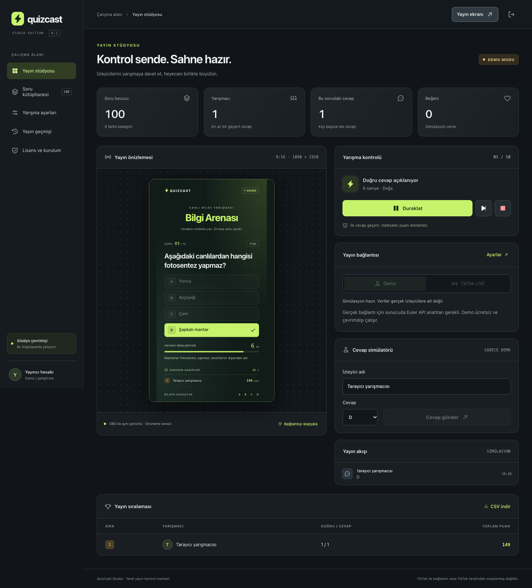
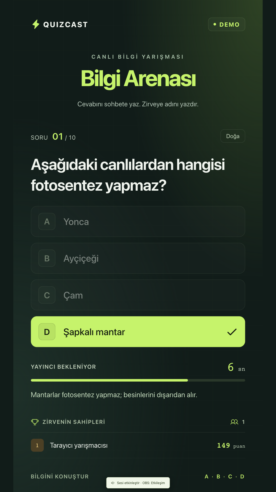
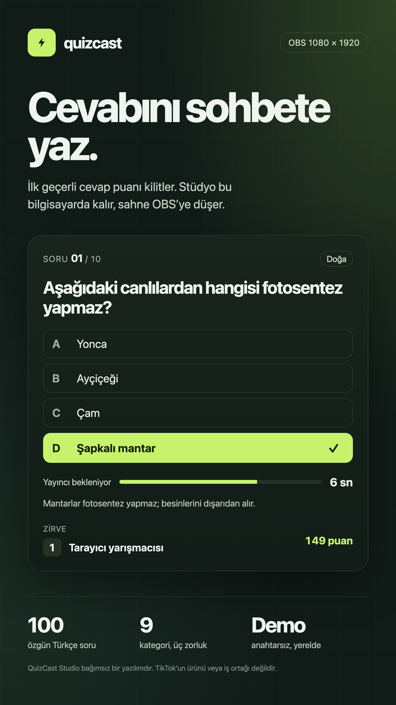

# QuizCast Studio

Local quiz studio for a live chat. Viewers answer with A, B, C, D or 1–4. The score stays on this computer. OBS gets a 9:16 browser source.

TikTok LIVE sohbetinden skor tutan yerel yarışma stüdyosu. Demo modu anahtarsız çalışır. Gerçek yayın, ayrıca bir sağlayıcı anahtarı ve bu kuruluma yazılmış lisans ister.



## Ne yapar

- İlk açılışta yönetici şifresi (en az 12 karakter), HttpOnly oturum, hatalı girişte hız sınırı.
- Demo modu: gerçek yayın olmadan cevap, beğeni ve hediye simülasyonu.
- Yarışma: süre, duraklat, ilk geçerli cevap kilitlenir, hız bonusu, liderlik.
- OBS ekranı: `/overlay?token=...`, 1080×1920, doğru şık ve açıklama süre bitmeden görünmez.
- 100 özgün Türkçe soru, 9 kategori, kolay / orta / zor. Ekle, düzenle, sil, JSON içe ve dışa aktar.
- Yayın geçmişi ve formül enjeksiyonuna karşı nötrlenmiş CSV.
- Ed25519 lisans. Özel anahtar müşteri kurulumuna girmez. Sağlayıcı anahtarı tarayıcıya yazılmaz.

Kategoriler: Coğrafya, Tarih, Bilim, Matematik, Dil ve Edebiyat, Teknoloji, Doğa, Spor ve Oyun, Sanat ve Kültür.

## Çalıştırma

Node.js `24` gerekir (`.nvmrc`).

```bash
npm ci
cp .env.example .env
npm run dev
```

Tarayıcıda `http://localhost:4317`. İlk ekranda yönetici şifresini oluştur. Sunucu yalnızca `127.0.0.1` dinler. Bu sürümü internete açma.

## Yayın ekranı



Afiş, aynı karenin poster hali. Tam boyutta açmak için [`docs/poster.html`](docs/poster.html).



## OBS

1. Panelde **Yayın ekranı** bağlantısını kopyala.
2. OBS → Kaynaklar → Tarayıcı. Genişlik `1080`, yükseklik `1920`.
3. Seslendirme için tarayıcı kaynağında etkileşimi aç ve ekrandaki ses düğmesine bir kez bas.
4. Bağlantı sızdıysa **Yayın bağlantısını yenile**. Eski adres kapanır.

## Skor nasıl işler

Cevap yalnızca tam `A`–`D` veya `1`–`4` ise sayılır. İlk geçerli cevap kilitlenir; yanlış cevap sonradan düzeltilemez. Sohbet cümlesi cevap hakkını yemez. Süre dolduktan sonra gelen cevap puan almaz. Duraklatma, hız bonusundan düşülür. Bağlantı koparsa yayın durur; bağlantı dönünce kendiliğinden devam etmez. Beğeni ve hediye puanı değiştirmez. Puanı tarayıcı söyleyemez, motor söyler.

## Dizilim

| Parça                    | İş                                                        |
| ------------------------ | --------------------------------------------------------- |
| `client/`                | React paneli ve yayın ekranı                              |
| `server/engine.ts`       | Deste, süre, kilit, puan                                  |
| `server/source.ts`       | Euler Stream çerçevesini skora girmeden önce sadeleştirir |
| `server/license.ts`      | Kurulum kimliğine bağlı Ed25519 doğrulama                 |
| `server/store.ts`        | SQLite: şifre (scrypt), sorular, oturum, geçmiş           |
| `shared/schema.ts`       | Ortak Zod şemaları                                        |
| `data/questions.ts`      | 100 soruluk başlangıç destesi                             |
| `scripts/license-cli.ts` | Satıcı anahtarı ve müşteri lisansı                        |

## Gerçek TikTok bağlantısı

```dotenv
EULER_API_KEY=server_only_key
```

Kullanıcı adını Ayarlar’a `@` koymadan yaz. Studio lisansı yoksa canlı bağlantı açılmaz. Demo anahtarsız sürer.

Bu adaptörün canlı davranışı sağlayıcı hesabına, kotaya, yayının açık olmasına ve güncel olay şemasına bağlıdır. Anahtarı koda, ekran görüntüsüne veya `VITE_` değişkenine koyma. Sağlayıcı ücreti bu depoya dahil değildir.

## Lisans üretmek

Satıcı makinesinde bir kez:

```bash
npm run license:keygen -- --out private-keys
```

Müşterinin paneldeki kurulum kimliğiyle:

```bash
npm run license:issue -- \
  --key private-keys/private.pem \
  --customer "Müşteri adı" \
  --installation "KURULUM-UUID" \
  --days 365 \
  --out customer.license.json
```

Müşteri `.env` dosyasında yalnızca açık anahtar durur:

```dotenv
LICENSE_PUBLIC_KEY_FILE=/güvenli/yol/public.pem
```

`customer.license.json` panelden yüklenir. `private.pem` müşteriye gitmez ve depoya girmez.

Kaynak kodun kendisi kişisel ve eğitim amaçlı yerel kullanım içindir. Satmak, kiralamak veya ücretli hizmet olarak sunmak ayrı yazılı izin ister. Ayrıntı `LICENSE` dosyasında.

## Kontroller

```bash
npm run typecheck
npm test
npm run build
PLAYWRIGHT_CHANNEL=chrome npm run test:e2e
```

`npm test` 43 Node testi çalıştırır. Playwright 5 akışı demo verisiyle paneli, soru kütüphanesini, ayarları, küçük ekranı ve lisans ekranını dolaşır. Gerçek TikTok hesabı gerekmez. Aynı komutlar `.github/workflows/check.yml` içinde de durur.

## Sınır

TikTok markası değildir ve TikTok tarafından onaylanmış gibi durmaz. Sağlayıcı sözleşmesi satış metnine ayrıca yazılır. İnternete açık çok kiracılı sürüm için TLS, CSRF, tenant ayrımı ve merkezi sır yönetimi bu depoda yoktur. KVKK metni de uygulama tarafından çözülmüş sayılmaz. Güvenlik notları: [SECURITY.md](SECURITY.md).
